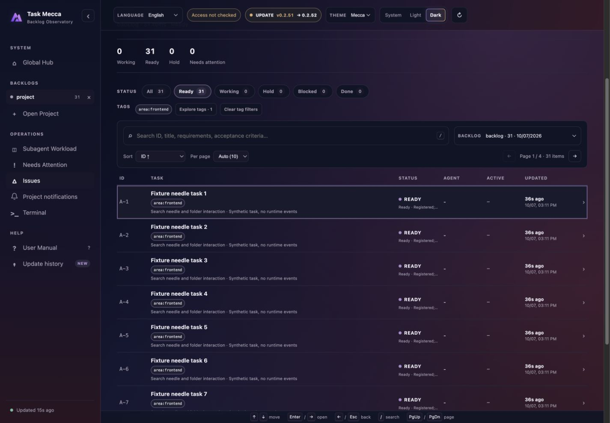
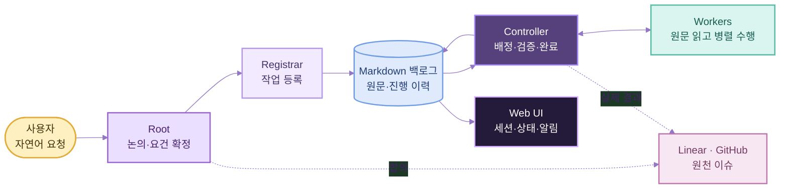

# Task Mecca

**AI 에이전트가 함께 수행하는 작업을 백로그로 관리하고, 실행 상태와 결과를 Web에서 확인하는 도구입니다.**  
Root와 자연어로 대화하면 Registrar·Controller·Worker가 등록부터 실행·검증까지 역할을 나눠 진행합니다.

[English](README.md) · [사용자 매뉴얼](goassets/template/_task_mecca/framework/README.md)

> [!IMPORTANT]
> **프로젝트의 시작과 감사**  
> Task Mecca는 동료 [gyusu](https://github.com/gyusu)가 공유한 **초기 소스와 백로그 기반 협업 아이디어**에서 출발했습니다. [이야기 더 보기 →](#project-origin)

## 빠른 시작

### 1. 설치

**macOS / Linux**
```bash
curl -fsSL https://raw.githubusercontent.com/silverkhan/TaskMecca/main/install.sh | sh
```

**Windows PowerShell**
```powershell
irm https://raw.githubusercontent.com/silverkhan/TaskMecca/main/install.ps1 | iex
```

### 2. Web UI 실행

```bash
task-mecca web
```

브라우저에서 **http://127.0.0.1:18765/** 로 접속합니다. 처음 사용할 프로젝트는 아래 3단계에서 초기화합니다.

Web은 **백로그 진행 상황**, **Root/Worker 세션과 최근 활동**, **실행 단계와 확인이 필요한 경고**를 한곳에 모읍니다. 프로젝트별 알림을 설정하면 **Telegram·브라우저 알림**도 받을 수 있으며, 업데이트와 프로젝트 관리도 지원합니다.



<sub>영문 · 다크 테마 · 샘플 프로젝트의 백로그 목록(Needs attention 0건). 이전 개발판의 실제 캡처로, 현재 화면과 일부 차이가 있을 수 있습니다.</sub>

### 3. 프로젝트 초기화

작업을 관리할 **프로젝트 폴더**에서 실행합니다.

```bash
cd /path/to/your/project
task-mecca init
```

다음은 주요 생성 파일입니다.

```text
프로젝트/
└── _task_mecca/
    ├── ROOT_PROMPT.md         # Root를 시작할 때 사용하는 프롬프트
    └── framework/
        ├── SESSION_GUIDE.md   # 세션 사용 안내
        ├── EXECUTION_PROTOCOL.md # 작업 수행·인계 규칙
        ├── collab.md          # 에이전트 협업 규칙
        └── roles/             # Root·Registrar·Controller·Worker 역할별 안내
```

> [!NOTE]
> **작업 목록(`data/backlog/`)은 초기화할 때 비어 있으며, 첫 작업을 등록할 때 생성됩니다.** 기존 프로젝트에서 `init`을 다시 실행하지 말고 5단계의 마이그레이션을 이용하세요.

### 4. Root 시작하기

같은 프로젝트 폴더에서 Codex 또는 Claude Code를 열고, **사용자와 대화할 세션 하나**를 Root로 지정합니다. 아래 프롬프트를 복사해 해당 세션에 붙여넣은 뒤 자연어로 작업을 요청하세요.

<details>
<summary><strong>Root 시작 프롬프트 펼치기 · 복사</strong></summary>

```text
이 세션에서는 Task Mecca의 Root로 동작해 주세요.
먼저 _task_mecca/framework/SESSION_GUIDE.md, _task_mecca/framework/collab.md, _task_mecca/framework/roles/root.md를 읽고 그 규약을 따르세요.
사용자에게 보이는 대화와 백로그의 제목·요약·요건·상태·결과는 사용자가 주로 쓰는 언어와 용어 감각을 기준으로 자연스럽게 작성하세요. 정확한 식별자·명령·경로·전문용어로 필요한 영문은 유지하되, 내부 영문 수식어·어순을 기계적으로 섞지 말고 전체 표현을 사용자 언어의 자연스러운 문장으로 재구성하세요.
Linear, GitHub Issue 등 연결된 외부 업무 항목에서 시작된 작업은 원천 항목을 읽고 백로그에 클릭 가능한 출처를 보존하세요. Root는 등록 전 또는 사용자와 활성 대화 중 확정된 중요한 합의를 원천 항목에 반영하고, 등록 이후 실제 작업 상태 변화와 완료 결과는 Controller가 연결된 도구를 통해 직접 반영하도록 하세요. Worker는 외부 이슈를 직접 수정하지 않으며 구현·검증 근거를 Controller에 보고하게 하세요. 외부 원천의 변경이 현재 Task Mecca 계약과 충돌해 사용자 판단이 필요하면 Controller가 임의로 합치지 말고 hold와 확인·후속에 차이와 재개 조건을 남기고, 다음 Root 대화에서 사용자와 재합의하세요.
실행형 작업을 subagent에 위임하기 전에는 SESSION_GUIDE의 Full Access preflight를 먼저 수행하세요.
작업을 Simple Task와 Defined Task로 구분하세요. 추가 해석 없이 바로 검증 가능한 단순 작업은 목표와 수용 기준만 기록하고 바로 등록하며, 범위·설계·사용자 선택이 필요한 작업만 요건 정의서를 작성해 제 확인을 받은 뒤 Registrar에 lossless하게 등록하세요.
아직 backlog가 없다면 Registrar가 첫 등록 시 _task_mecca/data/backlog를 생성하도록 하세요. data 아래의 내용은 project-owned이며 framework updater가 덮어쓰지 않습니다.
실행까지 승인된 작업을 Registrar에 넘기기 전에는 재사용 가능한 Controller의 정확한 runtime identity를 먼저 준비해 Registrar에 전달하고, Registrar가 등록 성공 직후 Root를 거치지 않고 Controller에 직접 인계하도록 하세요. Worker도 DONE/BLOCKED 시 같은 방식으로 Controller에 직접 인계하며, completed agent의 새 turn을 재개하기 직전에는 fresh Full Access preflight를 다시 수행하세요.
등록 이후에는 Controller가 작업 연속성과 의존성을 고려해 Worker에 배분하도록 하고, Root는 사용자-facing 창구로 유지하세요.
```

</details>

예: `로그인 API 오류를 수정하고 관련 테스트까지 확인해 줘.`

### 5. 프로젝트 마이그레이션

**Task Mecca를 업데이트한 뒤 기존 프로젝트의 작업 규칙·안내 파일도 새 버전에 맞춰야 할 때** 사용합니다. Web에 프로젝트 업데이트 안내가 나타나거나 기존 프로젝트에 `init`을 실행했을 때 마이그레이션을 안내받았다면 진행하세요.

```bash
cd /path/to/your/project
task-mecca migrate
```

- **바뀌는 것:** Task Mecca가 설치한 작업 규칙과 안내 파일
- **그대로 남는 것:** 기존 백로그, 작업 이력, 설정, 알림 정보, 실행 기록
- **직접 수정한 안내 파일이 있다면:** 덮어쓰기 / 수정본 백업 후 진행 / 취소 중 선택

프로그램 자체 업데이트는 `task-mecca upgrade`, **프로젝트 안내·규칙 업데이트는 `task-mecca migrate`** 입니다.

## 작동 구조



## 업데이트·도움말

- **업데이트:** Web의 업데이트 메뉴 또는 `task-mecca upgrade`
- **채널 확인·변경:** `task-mecca channel` / `task-mecca channel dev` / `task-mecca channel stable`
- **상태 확인:** `task-mecca web status` · **진단:** `task-mecca doctor`
- **자세한 사용법:** Web의 **사용자 매뉴얼**, [세션 안내](goassets/template/_task_mecca/framework/SESSION_GUIDE.md), [협업 규칙](goassets/template/_task_mecca/framework/collab.md)

<details>
<summary>고급 명령어 및 프로젝트 관리</summary>

| 명령 | 용도 |
| --- | --- |
| `task-mecca web restart` | Web 서비스 재시작 |
| `task-mecca status` | 백로그 상태 조회 |
| `task-mecca inspect <ID>` | 작업 상세 조회 |
| `task-mecca workload` | 에이전트 작업량 조회 |
| `task-mecca coordinate` | 작업 배정 상태 확인 |
| `task-mecca projects list` | 관리 중인 프로젝트 목록 |

Web에서 프로젝트를 **보관**하면 감시와 해당 알림이 중지되고, **다시 편입**하면 감시를 재개합니다. 목록에서 제거해도 원래 프로젝트 폴더는 삭제되지 않습니다.

</details>

<a id="project-origin"></a>

## 프로젝트의 시작과 감사

Task Mecca는 동료 [gyusu](https://github.com/gyusu)가 공유한 **백로그 등록·수행 세션을 분리하는 협업 아이디어**와 **활용 가능한 초기 소스**에서 시작되었습니다. Worker가 남은 백로그를 이어서 수행하는 구상은 현재의 Root·Registrar·Controller·Worker 협업 구조로 발전했습니다.

프로젝트의 출발점이 된 아이디어와 소스를 나누어 준 [gyusu](https://github.com/gyusu)에게 감사드립니다.

## 개발·라이선스

개발 환경 및 기여 방법: [CONTRIBUTING.md](CONTRIBUTING.md) · [MIT License](LICENSE)
