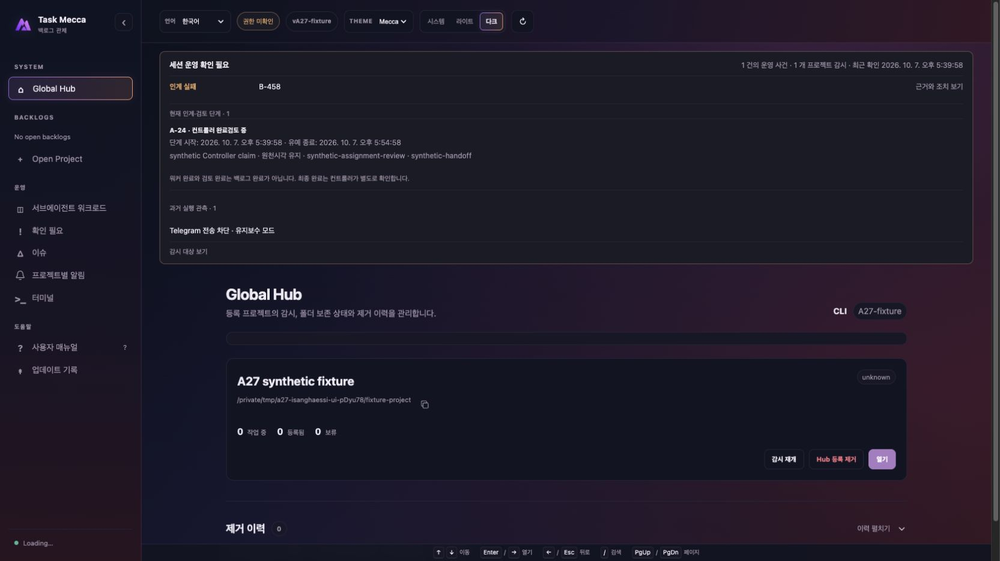
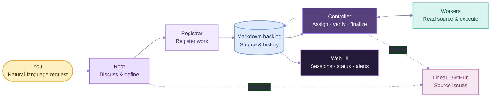

# Task Mecca

**Manage AI-agent work in a persistent backlog and monitor execution and results from the Web UI.**  
Talk to one Root in natural language; Registrar, Controller, and Workers handle registration, execution, and verification.

[한국어](README.ko.md) · [User manual](goassets/template/_task_mecca/framework/README.en.md)

> [!IMPORTANT]
> **Project origin & acknowledgements**  
> Task Mecca began with **initial source code and a backlog-driven collaboration idea** shared by my colleague [gyusu](https://github.com/gyusu). [Read more →](#project-origin)

## Quick start

### 1. Install

**macOS / Linux**
```bash
curl -fsSL https://raw.githubusercontent.com/silverkhan/TaskMecca/main/install.sh | sh
```

**Windows PowerShell**
```powershell
irm https://raw.githubusercontent.com/silverkhan/TaskMecca/main/install.ps1 | iex
```

### 2. Start the Web UI

```bash
task-mecca web
```

Open **http://127.0.0.1:18765/** in your browser. Initialize a working project in step 3.

The Web UI brings together **backlog progress**, **Root/Worker sessions and recent activity**, and **execution stages and actionable warnings**. You can configure project-level **Telegram and browser notifications**, manage projects, and update Task Mecca.



<sub>Actual development UI capture using a synthetic sample project. Screens and menus may vary by installed version.</sub>

### 3. Initialize a project

Run this in the **folder you want to manage**.

```bash
cd /path/to/your/project
task-mecca init
```

Key installed files:

```text
project/
└── _task_mecca/
    ├── ROOT_PROMPT.md           # Root startup prompt
    └── framework/
        ├── SESSION_GUIDE.md     # Session guide
        ├── EXECUTION_PROTOCOL.md # Execution and handoff rules
        ├── collab.md            # Collaboration rules
        └── roles/               # Root, Registrar, Controller, Worker
```

> [!NOTE]
> **The task backlog (`data/backlog/`) is created when the first task is registered, not by initialization.** For an existing installation, use migration in step 5 instead of rerunning `init`.

### 4. Activate your Root

Open Codex or Claude Code **in the same project folder**. Designate **one user-facing session** as Root, paste the prompt below, and describe work naturally.

<details>
<summary><strong>Expand & copy Root prompt</strong></summary>

```text
Act as the Task Mecca Root for this session.
First read _task_mecca/framework/SESSION_GUIDE.md, _task_mecca/framework/collab.md, and _task_mecca/framework/roles/root.md and follow those rules.
For all user-facing conversation and backlog prose—titles, summaries, requirements, status, and results—write natively in the user's primary language and vocabulary. Keep exact English identifiers, commands, paths, or technical terms when they improve precision, but do not mechanically leak internal English modifiers or word order into another language; restate the whole expression naturally in the user's language.
When work originates from a connected external item such as a Linear or GitHub issue, read that source and preserve a clickable source reference in the backlog. Root writes back important decisions confirmed before registration or during active user discussion. After registration, Controller is the single operational writer for real lifecycle transitions and completion results through the connected capability. Workers do not edit the external issue directly; they report implementation and verification evidence to Controller. If the external source changes in a way that conflicts with the current Task Mecca contract and requires user judgment, Controller must not merge it silently: put the task on hold, record the difference and resume condition in follow-up, and let the next Root interaction reconcile it with the user.
Before delegating executable work to subagents, run the Full Access preflight described in SESSION_GUIDE.
Classify work as Simple Task or Defined Task. For a simple task that is directly verifiable without additional interpretation, record only the goal and acceptance criteria and register it immediately. For work requiring scope, design, or user choices, prepare a requirement definition, get my confirmation, and then ask Registrar to register it losslessly.
If no backlog exists yet, Registrar creates _task_mecca/data/backlog on the first registration. Everything under data is project-owned and is never overwritten by the framework updater.
Before sending execution-authorized work to Registrar, prepare an exact reusable Controller runtime identity and pass it to Registrar so successful registration can hand off directly to Controller without another Root turn. Workers must likewise hand DONE/BLOCKED events directly back to Controller, and any resume that starts a completed agent's new turn requires a fresh Full Access preflight.
After registration, let Controller allocate work to Workers based on dependency and continuity, while Root remains the user-facing interface.
```

</details>

Example: `Fix the login API error and verify the relevant tests.`

### 5. Migrate an existing project

Use migration **after a Task Mecca update when the project's installed operating instructions need refreshing**. The Web UI or an `init` attempt in an existing project will guide you when migration is needed.

```bash
cd /path/to/your/project
task-mecca migrate
```

- **Updated:** Task Mecca-managed instructions and framework files
- **Preserved:** Your backlog, work history, configuration, notifications, and execution data
- **Customized files:** Choose overwrite / back up changes and continue / cancel

Use `task-mecca upgrade` to **update the application**, and `task-mecca migrate` to **update a project's instructions**.

## How it works



## Updates & help

- **Update:** Web UI update menu or `task-mecca upgrade`
- **Channels:** `task-mecca channel` / `task-mecca channel dev` / `task-mecca channel stable`
- **Service status:** `task-mecca web status` · **Diagnostics:** `task-mecca doctor`
- **Further reading:** Web **User Manual**, [session guide](goassets/template/_task_mecca/framework/SESSION_GUIDE.en.md), [collaboration rules](goassets/template/_task_mecca/framework/collab.md)

<details>
<summary>Advanced commands & project management</summary>

| Command | Purpose |
| --- | --- |
| `task-mecca web restart` | Restart the Web service |
| `task-mecca status` | Backlog status |
| `task-mecca inspect <ID>` | Task details |
| `task-mecca workload` | Agent workload |
| `task-mecca coordinate` | Scheduling snapshot |
| `task-mecca projects list` | Managed projects |

**Archive** stops monitoring and related alerts; **Restore** resumes monitoring. Removing a project from the list does not delete its folder.

</details>

<a id="project-origin"></a>

## Project origin & acknowledgements

Task Mecca grew from an **idea and usable initial source code** shared by my colleague [gyusu](https://github.com/gyusu): separate backlog registration and execution sessions, and let Workers continue through remaining tasks. The idea evolved into today's Root, Registrar, Controller, and Worker collaboration model.

Many thanks to [gyusu](https://github.com/gyusu) for sharing the inspiration and source material that started this project.

## Development & license

See [CONTRIBUTING.md](CONTRIBUTING.md) · [MIT License](LICENSE)
