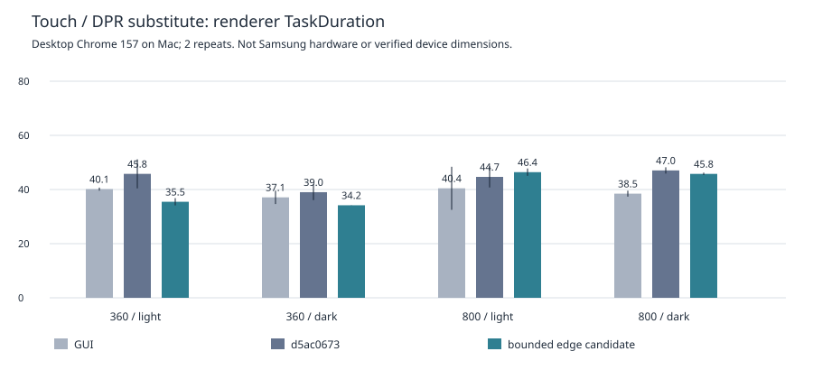

# 실사용 회귀 복원 후보 — 삼성 실기 해결·디자인 수용 아님

Production source: **8728dedf218d6904675b05cb7cf173e0e8a00fe1**. 기존 PR361 Draft/dev에 반영하는 후속 구현이며 새등록/새IA가 아니다.

사용자가 실제 실행한 **d5ac06733e7271f74bdde0e96ad10965004194bc**에서 스크롤 랙 지속과 디자인 미수용이 확정됐다. 원문:

> 여전히 스크롤 시에 랙이 심하다 / 기존 UX대비 개선된 체감이 없다 / UI도 기존이 훨씬 깔끔하다. / 좌측 메뉴 아이콘도 기존이 직관적이다. 지금은 중복이 많다. / 불투명도 또한 들죽날쭉이며, 백로그 본문이 분산되어 있어 오히려 탐색이 힘들다. 기존에는 한 번에 다 보여주면서도 앵커기반 네비게이터를 항상 제공해서 편리함도 확보됨. 또한 플로팅 인덱스도 지원.

재현환경 원문:
> 이제보니 모바일에서 느립니다. (삼성브라우저 - z fold8 ultra, 펼쳤을때, 접었을때 둘 다.)

기기명은 원문 그대로 두고 정정·추정하지 않는다. 실제 OS/삼성 인터넷 버전/viewport/DPR/주사율/확대율/가속여부는 미확인이다. Root 합의 [6753067542](https://github.com/silverkhan/TaskMecca/pull/361#issuecomment-6753067542), 환경 기록 [6753999229](https://github.com/silverkhan/TaskMecca/pull/361#issuecomment-6753999229). d5ac의48/48 timing·8/8 CI 성공은 역사로 보존하고 실사용 해결 근거로 쓰지 않는다.

## 실제 구현

- 기존 GUI 실제 소스의 메뉴 의미를 복원: 선반/분기/구획/터미널/물음표/업데이트/시계/경고 등 고유 SVG. 동일 폴더·activity 아이콘 재사용 제거. 기존 그룹·위치·프로젝트 직접 진입·기능은 유지한다.
- 배타적4탭 대신 한 연속 문서. 개요·결과·작업 흐름·연결/운영근거·요건·메모·검증과 원문을 같은 DOM에 두고 기존 순서와 canonical 앵커 ID를 복원한다. 본문별 내부 스크롤 제한을 제거한다. 우측 상시 sticky 목차와 기존 desktop/mobile floating index 배치·Escape·focus·refresh hash를 복원한다.
- 원래 GUI의 깔끔함을 기준으로 반복 panel/rim/광택과 간격을 정리하고 하나의 viewport 읽기 면을 공유한다. 역할별 tint가 같고 행별 효과는 없다. 곡률·투과·7px blur·실제 edge displacement·rim은 유지한다. 원본사진/로고/material파일/다른theme/환경전환API는 변경하지 않는다.
- 삼성/터치 환경은 큰 면 전체에 SVG displacement를 적용하지 않는다. native7px blur와 **최대24px 가장자리 띠**를 분리한다. 띠는 이미 흐린 배경을 실제 SVG 공간맵으로 변위시킨다(반사광만 얹은 것이 아님). 교차 corner 중복을 피하고 접힘/펼침 resize에서 map좌표를 갱신한다. 좁은 화면 header는 같은 면을 공유한다. `lvh`로 주소창 등 visual viewport 변화 시 큰 면 재할당을 제한한다. 지원이 없는 엔진은 blur/rim fallback이며 삼성 실기 edge지원은 미검증이다.
- 새 복원 경로에서 발견한 late-activity 읽기 회귀도 수정했다. 조건부 응답 바리어에서 사용자500px이동 뒤 **+816px** 점프가 재현됐다. 초기 anchor와 사용자 입력 intent를 고정해 일반 진입/fresh deep URL 모두 **delta0**으로 확인했다. 값은 `late-reading-*`에 보존. 필수API를 삭제하거나 완료 타이밍을 gate에 맞춰 조작하지 않았다.

## 검증 범위와 한계

`mobile-proof/results.json`: desktop Chromium157에서 **대표**360×800/DPR3,800×900/DPR2.5,터치·합성SamsungUA,Light/Dark4조건. 이 값은 실제 기기의 접힘/펼침 스펙이 아니다. 좁은SVG띠/큰면nativeblur, 실제사진edge22vs0 RGBΔ1.10~1.52/centerΔ0/touch-scrollΔ0,viewport resize·배경toggle·Light/Dark/System4/4PASS. 물리Samsung/실제Samsung renderer 검증이 아니다. crop은 재질 primitive용으로 제품화면 검수 라운드를 추가한 것이 아니다.

`samsung-budget/raw.json`: 같은20행/600px touch compositor gesture, 각2회 교차순서, GUI/d5ac/이전native후보/제한된edge후보. 실제엔진은 desktop Chrome157/M5Pro이며 **대체검증**이다. 좁은경우Task중앙값d5ac45.8/39.0→35.5/34.2ms,넓은경우44.7/47.0→46.4/45.8ms로mixed. p95는대체로16.7ms이므로심한실사용랙을이환경에서동일재현하지못했다. 이작은수집을원래48group/8pair/10%gate나실기해결로승격하지않는다. rAF추정missed60Hz와trace DroppedFrame event수는물리presentation dropped수와다르다. Paint/Raster/Draw event비용·heap·레이어크기원시를보존하고GPUmemory/energy로오인하지않는다.

모바일photosampling/CSSfilter·전체SVG이미지·edge이미지·promotion실험은일부조건CPU악화가있어 **기각**했다. `samsung-substitute/static/edge/layer` 및asset snapshots/patch에원시·소스를보존하며현재제품경로가아니다. 최종경로에는파일인코딩·생성이미지·canvas·CPUoptics·상시rAF가없다.

`final-regression.tap` 기존core/expansion/P0returnDev/workflow browser5/5PASS(초기복원source경계). `confirm`후보10조건,`reference`GUI4조건,`mechanics`최종본문순서10조건과`late-reading`회귀2조건,`optics-chrome157`기존native광학4조건/UAfallbackPASS. units31PASS/기존조건부6SKIP. 자세한소스경계는README와source-map에명시한다. 기존동작검사를삭제·완화하지않고readonly검사는실제shared blur면의존재·정렬을검사한다.

전체UI시각검수는초기batch→일괄fix→confirm1회로제한했다. 보존한제품PNG는c7공유면/최종본문순서·읽기guard·삼성budget추가전의경계가있다. 삼성기기에서현재후보를사용자가수용했다는증거는없다. 새로운전체시각review delegate0. 원래Pane·f3자료는그대로보존한다.

첫4203 fullrun은소스/assets안정이었으나Chrome156→157 바이너리교체가관측돼 **INVALID_SOURCE_OR_BINARY**. 관측6그룹초과도그대로보존하고PASS재분류하지않았다. 최신8728 source의원래byte동일48group/8pair/10%gate와immutableidle는별도`a65-samsung-edge-gate`에기록한다. 기존idle26/27 FAIL 정책충돌을API예외로임의해제하지않는다.

## 최종 고정 run 결과와 잔여

8728 source / Chrome157 **44/48 PASS·4FAIL**, raw54pair(6warmup)/invalid0/source·assets·Chrome stabletrue. 임계값·하네스·필수API 변경0.

|Viewport/theme|항목|TaskDuration 상대 차이|판정|
|---|---|---:|---|
|1440 Light|navigation|+14.889%|FAIL|
|1440 Dark|navigation|+18.122%|FAIL|
|1280 Light|navigation|+12.566%|FAIL|
|390 Light|search|+13.973%|FAIL|

immutable idle **26/27 FAIL**. settings 초기 `/api/version`, `/api/runtime/hooks`, `/api/channel-options`각1회,stream0과all-API-zero판정의충돌유지. 기본성능gate4실패도별도로유지한다. 전체기술완료/merge-ready/최종user디자인hold로승격하지않는다.

`fixture-conformance.json`은원래fixture를수정하지않은별도read-only probe다. 두UI가받은JSON은동일한defined-v2 schema/requirements(goal+acceptance)이지만 `contract_kind:null`이다. 기존GUI는legacy분기로requirements0/goalVisiblefalse,후보는requirements1/goalVisibletrue였다. **현재navigation의실제렌더작업량은같지않다.** 이사실만으로navigation실패의원인을단정하거나FAIL을재분류하지않는다. 요건을숨기거나fixture/harness를임의변경해통과시키지않았다. 별도정합성판단이필요하며search초과는여전히독립미해결이다.

원시·heap·레이어크기·Paint/Raster/Draw비용과추정frame수는 `samsung-summary.json`/`samsung-budget`을참조한다. missing metric은null이고0으로메우지않았다. 차트범위는각2회관측범위이며통계적신뢰구간이아니다. 물리기기해결의증거로쓸수없다.

Samsung물리/Safari/Firefox/실제OS200%/screenreader/GPUmemory·energy/실사용환경성능은미실행. 서비스18765/57069설치·restart·전환/merge/deploy0. 새delegate0. 이전completedidentity/hook/JSONL조작0. 전체AC8미체크·사용자최종디자인미수용·정책hold를유지한다.
